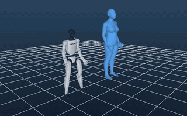
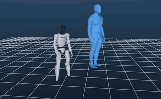
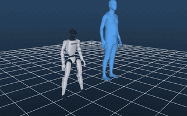
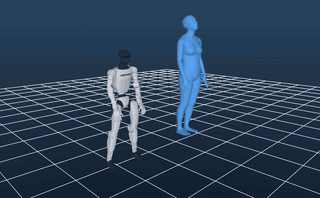
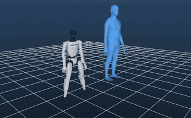
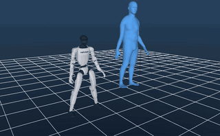

# ReActor reproduction (arXiv 2605.06593)

Reimplementation of *ReActor: Reinforcement Learning for Physics-Aware Motion Retargeting*
(Müller et al., SIGGRAPH 2026) for the Unitree G1 on AMASS, using MuJoCo Warp instead of Isaac Sim.

A PPO tracking policy (lower level) and the retargeting parameters (upper level) are trained
jointly. The retargeted motion is what the robot does in simulation, so it respects contacts,
joint limits and self-collision.

## Results on AMASS

Each clip shows the original AMASS human (blue) next to the G1 driven by the trained ReActor
policy in MuJoCo Warp, with no kinematic post-processing.

| | | | |
|:-:|:-:|:-:|:-:|
| <br>walk, turn left 45° | <br>stand to run | <br>cha-cha | <br>high kick |
| <br>jump back | <br>kneel down to crawl | <br>squat | <br>throw |

Clips: `ACCAD/Female1Walking_c3d/B10`, `ACCAD/Male2Running_c3d/C1`, `KIT/572/dance_chacha01`,
`KIT/200/KickHuefthoch01`, `KIT/3/jump_back02`, `KIT/3/kneel_down_to_crawl01`, `KIT/3/squat01`,
`KIT/3/throw_left01`. The GIFs are reduced previews. `scripts/render_amass.py` regenerates the
full 1280×720 MP4s with clip labels (see [Rendering](#rendering)).

### Metrics (5,078 clips, ACCAD + CMU + KIT)

`scripts/evaluate.py`: every clip played once from frame 0 with the deterministic policy.

| | Ground pen. depth | Self-pen. time | Foot slide | Foot float | Success |
|---|---|---|---|---|---|
| ReActor (bilevel) | 0.16 cm | 2.14 s | 35.9 cm/s | 0.09 cm | 96.0 % |
| RL only (`--no-bilevel`) | 0.15 cm | 1.42 s | 33.3 cm/s | 0.11 cm | 95.0 % |
| *Paper, ReActor on G1 (Tab. 4)* | *0.00 cm* | *0.00 s* | *0.17 cm/s* | *0.12 cm* | — |

Status of the reproduction:

- **Training behaves as in the paper.** The bilevel run ends with a lower upper-level loss than
  RL-only (3.45 vs 4.73) and a slightly higher success rate.
- **The paper's artifact improvements are not reproduced.** ReActor is not better than RL-only on
  the artifact metrics.
- **Foot sliding is far higher than reported** (36 cm/s vs 0.17 cm/s). Two likely causes:
  - the source-contact estimate is a coarse height/velocity heuristic;
  - the policy still relies on the residual root wrench, about 108 N on average at its peak.
    Raising the force penalty (`--force-weight`, paper Fig. 8) is the obvious next experiment.

## Setup

Requirements: Linux, an NVIDIA GPU (developed on an RTX 5090, 32 GB), [uv](https://docs.astral.sh/uv/),
`git`, and `ffmpeg` for rendering.

### 1. Clone and install

```bash
git clone https://github.com/damtien444/reactor.git
cd reactor
uv sync                      # creates .venv with torch, mujoco, mujoco-warp, warp-lang, ...
export PYTHONPATH=$PWD       # every command below assumes this
```

### 2. Robot model

The Unitree G1 (29 DoF) MJCF and meshes come from
[holosoma](https://github.com/amazon-far/holosoma). They are not stored in this repo:

```bash
scripts/fetch_assets.sh      # -> assets/g1/ (pinned holosoma commit)
```

### 3. AMASS and SMPL+H (registration required)

Both are free for research but need an account. Download them yourself and accept the licences.

1. **AMASS motions** from <https://amass.is.tue.mpg.de> (*Download → Body Data*). Get the
   **SMPL+H G** archives of the subsets you want. This repo was trained on **ACCAD, CMU and KIT**
   (about 4 GB compressed). Other subsets work too, since everything under `data/amass/` is used.
2. **SMPL+H body model** from <https://mano.is.tue.mpg.de> (*Download → Extended SMPL+H model*,
   `smplh.tar.xz`). It is used for the subject skeletons (with betas) and for the human meshes in
   the videos.

Extract them so the tree looks like this:

```bash
mkdir -p data/amass data/body_models/smplh
tar -xjf ACCAD.tar.bz2 -C data/amass
tar -xjf CMU.tar.bz2   -C data/amass
tar -xjf KIT.tar.bz2   -C data/amass
tar -xJf smplh.tar.xz  -C data/body_models/smplh
```

```
data/
├── amass/
│   ├── ACCAD/<subject>/*_poses.npz
│   ├── CMU/<subject>/*_poses.npz
│   └── KIT/<subject>/*_poses.npz
└── body_models/smplh/
    ├── female/model.npz
    ├── male/model.npz
    └── neutral/model.npz
```

### 4. (Optional) Seamless Interaction

Only needed for `scripts/render_seamless.py`. Download
[Seamless Interaction](https://huggingface.co/datasets/facebook/seamless-interaction) (the
`improvised` / `naturalistic` splits with `smplh/` and `*.wav`). Then place it at
`data/seamless_interaction/`, or point to it:

```bash
ln -s /path/to/seamless_interaction data/seamless_interaction   # or: export SEAMLESS_ROOT=/path/to/...
```

## Usage

### Preprocess → train → evaluate

```bash
uv run python scripts/prep_amass.py                         # -> data/processed/amass_g1.npz
uv run python scripts/train.py --run reactor_g1             # 20k iterations, ~2.2 h on an RTX 5090
uv run python scripts/train.py --run rlonly_g1 --no-bilevel # ablation (Fig. 6)
uv run python scripts/evaluate.py --run reactor_g1          # -> runs/reactor_g1/eval.txt
uv run python scripts/plot_training.py                      # -> runs/fig6_training_curves.png
```

- **Outputs:** checkpoints go to `runs/<run>/model.pt` every 500 iterations. TensorBoard logs are
  in `runs/<run>/`.
- **Resuming:** use `--resume runs/<run>/model.pt`.
- **Fewer envs:** `--num-envs` lowers the environment count for smaller GPUs.
- **Both runs at once:** `scripts/run_main.sh` runs the two training runs back to back.

### Rendering

Rendering uses MuJoCo's OpenGL renderer. If headless EGL fails (as on the development machine),
render through GLFW on an X display:

```bash
# original human next to the robot; without --clips it renders the eight clips shown above
DISPLAY=:1 MUJOCO_GL=glfw uv run python scripts/render_amass.py \
    --clips "KIT/3/squat01_poses.npz" "KIT/572/dance_chacha01_poses.npz"   # -> renders/amass/*.mp4

# one Seamless Interaction subject replaced by the robot, partner stays human
DISPLAY=:1 MUJOCO_GL=glfw uv run python scripts/render_seamless.py \
    --segments V00_S1216_I00001053_S0_6000_6300                            # -> renders/seamless/<segment>/
```

- **Arms only:** `render_seamless.py --arms-only` retargets only the replaced subject's arms. The
  reference has the torso upright and the legs straight; the simulated policy keeps balance against
  the arm motion. Output: `robot_reactor_arms.mp4`.
- **Clip and segment names:**
  - `--clips` takes paths relative to `data/amass`. They must have passed the dataset filter in
    `prep_amass.py`.
  - Segment names are `<interaction>_S<subject>_<start>_<end>`, where start and end are 30 Hz frame
    indices and the subject index is 0 or 1.
- **Reusing a holosoma report:** if a holosoma seamless report folder exists (`HOLOSOMA_REVIEW`,
  default `../holosoma/src/holosoma_retargeting/reports/review`), `render_seamless.py` reuses its
  segment list, audio and subtitles.
- **Reproducibility:** rollouts are seeded, so re-rendering gives the same motion. GPU
  floating-point ordering leaves differences of about 1e-4 in joint angles, which are not visible.

On machines where headless EGL works, `MUJOCO_GL=egl` needs no display.

## Layout

| File | Paper |
|---|---|
| `reactor/robot.py` | G1 model, PD gains, nominal T-pose, sparse correspondences (Fig. 4) |
| `reactor/smplh.py` | SMPL+H skeleton FK (body joints) |
| `reactor/source.py` | Source tracks: resampling to 50 Hz, scale `s`, `x_nom`, `R_nom` (Eqs. 8–9), `z_nom`, source contacts |
| `scripts/prep_amass.py` | AMASS → `data/processed/amass_g1.npz`, with a PHC-style name filter |
| `reactor/motion.py` | Parameterized mapping `g_t` (Eqs. 10–13), projection onto `P` (Eq. 14) |
| `reactor/env.py` | Lower-level RL environment (Sec. 6): PD + residual root wrench with deadband (Eqs. 18–19), observations (Eq. 20), retargeting phase ψ, adaptive sampling, rewards (Tab. 1) |
| `reactor/ppo.py` | PPO with adaptive LR, MLP 3×512 ELU (Tab. 2) |
| `reactor/bilevel.py` | Upper level: TTSA single-loop update with simplified gradient (Eqs. 3, 6, 7, 15–17) |
| `scripts/train.py` | Joint training; `--no-bilevel` gives the RL-only ablation |
| `scripts/evaluate.py` | Table 3/4 kinematic metrics + export of retargeted trajectories |
| `scripts/plot_training.py` | Fig. 6 curves |
| `reactor/render.py` | Shared rendering: policy rollouts, SMPL+H skins in MuJoCo, camera, encoding |
| `reactor/seamless.py` | Seamless Interaction loading and two-person slot placement (holosoma conventions) |
| `scripts/render_amass.py` | AMASS clips: original human next to the ReActor-driven G1 |
| `scripts/render_seamless.py` | Seamless Interaction: one subject replaced by the ReActor-driven G1 |
| `scripts/fetch_assets.sh` | Downloads the G1 model from holosoma |

## Deviations from the paper

- **Simulator:** MuJoCo Warp instead of Isaac Sim (uv-managed env). 4096 envs, 200 Hz physics, 50 Hz control.
- **Data:** AMASS subsets ACCAD + CMU + KIT (15.7 h after filtering) instead of the full PHC-filtered AMASS.
  The PHC filter is approximated by excluding clips whose names indicate object/scene interaction.
- **Upper-level step size:** η = 1e-4 (the paper does not report η). With 1e-2 the parameters hit the
  bounds of `P` within a few hundred iterations.
- **Unspecified details chosen here:**
  - wrench scales: 100 N / 20 Nm per action unit;
  - adaptive-sampling termination thresholds: 0.5 m root, 45° torso;
  - ψ ramp of 1 s and a warm-start of 1000 iterations;
  - two future reference frames in the observation;
  - source-contact heuristic based on height and velocity thresholds.
- **Not reproduced:** GMR / OmniRetarget baselines, the downstream tracking policy (Tab. 4 right part),
  Lima and ANYmal targets, and hardware experiments.

## Licences

This repo contains code and the preview GIFs above, which are renders of retargeting results. No
dataset files, body models or robot meshes are included. The datasets and models are covered by
their own licences:

- **AMASS and SMPL+H:** non-commercial research licences from MPI-IS. Do not redistribute the data
  or derived meshes.
- **G1 model:** from holosoma; see that repo's licence.
- **Seamless Interaction:** see its dataset card.
